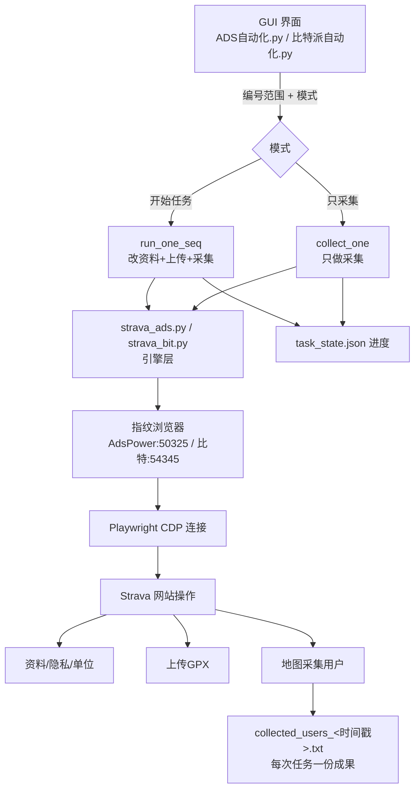
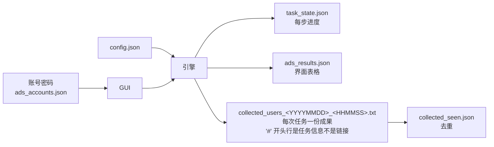
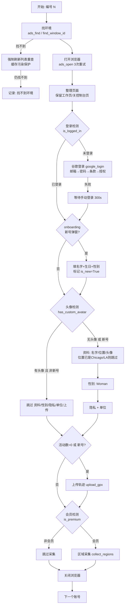
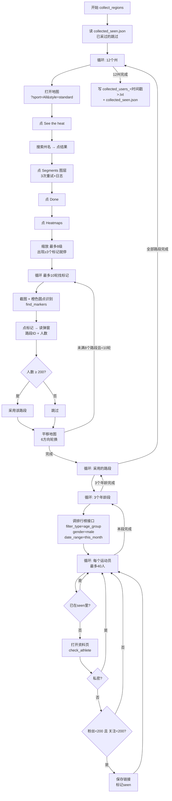
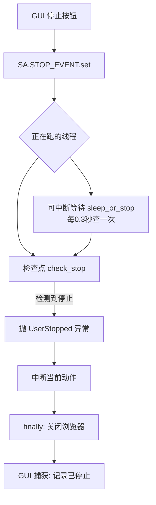

# Strava 自动化脚本 — 详细流程工作结构图

> 版本: 2026-09-17 (含区域采集 / 立即停止 / 会员检测修复)
> 两套脚本功能一致：`strava_bit.py`(比特浏览器) / `strava_ads.py`(AdsPower)
> 主脚本各约 2700 行 / 66 个函数，GUI 各 518 行

---

## 目录

1. [系统总览](#一系统总览)
2. [主任务流程（10步）](#二主任务流程)
3. [区域采集流程（重点）](#三区域采集流程)
4. [停止机制](#四停止机制立即停止)
5. [文件结构](#五文件结构)
6. [模块/函数清单](#六模块函数清单)
7. [状态与数据文件](#七状态与数据文件)
8. [两版差异对照](#八两版差异对照)
9. [关键选择器/接口](#九关键选择器接口实测)
10. [参数配置表](#十参数配置表)
11. [常见问题与排查](#十一常见问题与排查)

---

## 一、系统总览



**数据流**



---

## 二、主任务流程



**每一步的状态记录**（`task_state.json`，键按版本隔离）

| 步骤 | 状态键 | 说明 |
|---|---|---|
| onboarding | `is_new` | 新号标记，后续流程按新号处理 |
| 资料 | `name` / `location` / `avatar` | 值与目标一致则跳过 |
| 性别 | `gender` | `woman` |
| 隐私 | `privacy` | `true` |
| 单位 | `units` | `feet` |
| 上传 | `uploaded[]` | 已传文件列表 |
| 采集 | `collected` | 日期 |

---

## 三、区域采集流程

> 需求：12个州 / 路段人数≥200 / 男性 / 45-54+55-64+65-69岁 / 本月 / 粉丝和关注都<200 / 排除私密



**排行榜接口（实测）**

```
/frontend/segments/<路段ID>/leaderboard
    ?filter_type=age_group
    &filter_value=45_54 | 55_64 | 65_69
    &gender=male
    &date_range=this_month
    &page=N
→ JSON: leaderboard[] {displayName, athleteIdStr}, totalCount
```

**用户筛选逻辑（check_athlete）**

```
打开 https://www.strava.com/athletes/<id>
  ├─ 页面含 private/私密 → 淘汰
  ├─ 找标签 <Following> / <Followers> 元素
  │   读父容器里的数字（标签定位法，实测可靠）
  ├─ 粉丝 ≥ 200 → 淘汰
  ├─ 关注 ≥ 200 → 淘汰
  ├─ 两者都 < 200 → 合格，保存
  └─ 读不到 → 重试2次(等4秒)，仍失败则淘汰
```

---

## 四、停止机制（立即停止）

> 需求：按停止必须立刻中断，不等当前账号跑完



**检查点分布（每版 13+ 处）**

| 位置 | 说明 |
|---|---|
| 区域循环开始 | 每换一个州检查 |
| 找标记每轮 | 地图平移前检查 |
| 路段循环 / 年龄段循环 | 每次请求前检查 |
| 每个运动员检查前 | 最细粒度，约12秒一个 |
| 上传每批 | 每15个文件 |
| 资料/性别/隐私/单位/上传/采集 | 每步开始前 |
| `goto_retry` | 所有页面跳转前 |
| `is_premium` 轮询 | 每1.5秒 |
| 地图流程各等待 | `sleep_or_stop` 替代 `time.sleep` |

**实测效果**

| 场景 | 旧 | 新 |
|---|---|---|
| 采集途中停止 | 37.3秒 | **0.5秒** |
| GUI路径(collect_one) | 等账号跑完(数小时) | **2.2秒** + 浏览器自动关闭 |

**浏览器清理**

| 方式 | 行为 |
|---|---|
| 停止按钮 | 中断 + 关闭该浏览器（不管是否勾选"完成关浏览器"） |
| 「✕ 关闭全部浏览器」按钮 | 关闭所有已打开环境（清残留） |
| 关闭GUI窗口 | 自动停止 + 关闭所有浏览器 |

---

## 五、文件结构

```
项目根目录（桌面运行位置）
├── strava_ads.py           # ADS版主脚本 (2702行/66函数)
├── strava_bit.py           # 比特派版主脚本 (2681行/64函数)
├── ADS自动化.py             # ADS GUI (518行)
├── 比特派自动化.py          # 比特派 GUI (518行)
├── config.json             # 主配置(区域/筛选/上传参数)
├── accounts.json           # 账号密码(70条)
├── ads_accounts.json       # ADS账号密码(50条)
├── bit_accounts.json       # 比特派账号密码(20条)
├── windows.csv             # 50窗口名字+头像分配
├── task_state.json         # 每账号进度状态
├── ads_results.json        # ADS界面表格数据
├── bit_results.json        # 比特派界面表格数据
├── scan_results.json       # 扫描结果
├── collected_users_<YYYYMMDD>_<HHMMSS>.txt   # 每次任务一份成果(汇总)
│                                              #   号级明细再加 _<号>
│                                              #   '#' 开头行是任务信息, 不是链接
├── collected_users.txt     # 历史总表(收尾合并去重后的累计, 仍然保留)
├── collected_seen.json     # 采集去重(按athlete id)
├── upload_counter_*.txt    # 每日上传计数
└── logs/                   # 运行日志 + 出错截图
```

---

## 六、模块/函数清单

### 配置与工具

| 函数 | 作用 |
|---|---|
| `CFG` | config.json 加载 |
| `log` | 日志(同时转发到GUI) |
| `human_delay` | 随机等待(拟人) |
| `load_state` / `save_state` / `mark_step` | 状态读写 |
| `pending_todo` | 判断该账号待做哪些步骤 |
| `sort_gpx` | 轨迹按日期排序 |
| `pick_avatar` / `pick_avatars` | 头像分配 |

### 停止控制（新增）

| 函数 | 作用 |
|---|---|
| `STOP_EVENT` | 全局停止信号(threading.Event) |
| `UserStopped` | 停止异常 |
| `check_stop()` | 检查点，停止则抛异常 |
| `sleep_or_stop(sec)` | 可中断等待 |

### 浏览器适配层

| 比特派 | ADS | 作用 |
|---|---|---|
| `bb(path,data)` | `ads_req(path,**p)` | API请求 |
| `find_window_id(name)` | `ads_find(编号)` | 找环境 |
| `open_window(wid)` | `ads_open(uid)` | 打开(ADS带3次重试) |
| `close_window(wid)` | `ads_close(uid)` | 关闭 |
| `bit_close_all()` | `ads_close_all()` | 关闭全部(清理残留) |
| - | `ads_list(size,use_cache)` | 列表(缓存120s+短列表保护) |

### Playwright 助手

`shot` `step` `human_click` `human_type` `goto_retry` `accept_cookies` `scroll_to_bottom` `wait_url` `exact_btn`

### Strava 操作

| 函数 | 作用 |
|---|---|
| `is_logged_in` | 登录检测 |
| `google_login` | 谷歌登录全流程(语言无关) |
| `do_onboarding` | 新号弹窗(名字/生日/性别) |
| `has_custom_avatar` | 头像检测 |
| `current_location` / `location_ok` | 位置检测 |
| `is_premium` | 会员检测(轮询18秒) |
| `profile_activity_count` / `count_activities` | 活动数 |
| `set_profile` / `set_gender` / `set_privacy` / `set_units` | 资料设置 |
| `upload_gpx` / `upload_errors` | 上传+红警告检测 |

### 采集模块

| 函数 | 作用 |
|---|---|
| `find_markers` | 截图识别橙色路段标记(numpy/PIL) |
| `segment_from_popup` / `popup_athletes` | 弹窗读路段ID/人数 |
| `fetch_lb_filtered` | 排行榜接口(年龄/性别/时间) |
| `check_athlete` | 粉丝/关注筛选(标签定位法) |
| `collect_regions` | **区域采集主流程** |
| `collect_users` | 旧版单城市采集 |

### 主流程

| 函数 | 作用 |
|---|---|
| `run_one` | 单账号完整流程 |
| `run_one_seq` | GUI调用:按编号跑任务 |
| `collect_one` | GUI调用:只采集 |
| `scan_one` | 扫描账号状态 |
| `main` | CLI入口 |

---

## 七、状态与数据文件

### task_state.json

```json
{
  "_12": {                       // 比特派窗口
    "is_new": true,
    "location": "Chicago, Illinois",
    "avatar": "C:/.../xx.jpg",
    "gender": "woman",
    "privacy": true,
    "units": "feet",
    "uploaded": ["C:/.../4.1.gpx"],
    "collected": "2026-09-17"
  },
  "ads_3": { ... }               // ADS环境(前缀隔离)
}
```

### collected_seen.json

```json
{ "89031329": true, "63685581": true }
```
> 按 athlete id 去重，跨账号共享

### ads_results.json / bit_results.json

```json
{
  "35": {
    "seq": "35", "win": "35",
    "email": "...", "password": "...",
    "login": "是", "name": "", "city": "",
    "acts": "", "prem": "", "priv": "", "note": ""
  }
}
```

---

## 八、两版差异对照

| 项目 | 比特派版 | ADS版 |
|---|---|---|
| 浏览器 API | `127.0.0.1:54345` | `127.0.0.1:50325` |
| 认证 | 无 | `Authorization: Bearer <key>` |
| 限速 | 无特殊 | 全局锁 + 1.2秒间隔 |
| 状态键 | `_12` | `ads_12`（隔离） |
| 打开方式 | `/browser/open` | `/api/v1/browser/start` |
| 关闭方式 | `/browser/close` | `/api/v1/browser/stop` |
| 后台运行 | 支持最小化 | 由ADS控制 |
| **隐私项** | **4项(含关注者可见)** | **3项(不设关注者)** |
| 其余功能 | 完全一致 | 完全一致 |

---

## 九、关键选择器/接口（实测）

| 用途 | 值 |
|---|---|
| 谷歌下一步 | `#identifierNext button` / `#passwordNext button` |
| 条款页按钮 | 滚到底点 `我了解/ຂ້ອຍເຂົ້າໃຈ/I understand` |
| 头像检测 | `img[src*="pictures/athletes"]` |
| 会员检测 | `alt="Subscriber"`（设置页Membership Status行） |
| 活动数 | 控制面板 `Activities` 标签旁数字 |
| 位置输入框 | `input[name='geo-search-box-input']` |
| 隐私(关注者) | `input[name='profile_visibility'][value='followers_only']` |
| 隐私(小组) | `input[name='group_activity_visibility'][value='no_one']` |
| 上传文件框 | `input[name='files[]']` |
| 上传保存按钮 | `保存并查看` / `Save & View` |
| **排行榜接口** | `/frontend/segments/<id>/leaderboard?filter_type=age_group&filter_value=65_69&gender=male&date_range=this_month&page=N` |
| 地图页URL | `/maps/global-heatmap/segments?sport=All&style=standard&terrain=false` |
| 地图路段标记 | 截图+橙色圆形识别（Canvas绘制，DOM里没有） |
| 地图图层按钮 | `Segments` → `Done` → `Heatmaps` |
| 资料页粉丝/关注 | 标签元素 `Following`/`Followers` 的父容器数字 |

---

## 十、参数配置表

```json
{
  "collect_regions": ["Indiana","Michigan","Wisconsin","Iowa","Missouri","Ohio",
                      "Kentucky","Minnesota","Tennessee","West Virginia","Pennsylvania","New York"],
  "min_athletes": 200,        // 路段人数门槛
  "max_followers": 200,       // 粉丝和关注都要低于这个数
  "segs_per_region": 8,       // 每州采集路段数
  "check_per_segment": 40,    // 每路段每年龄段最多查人数
  "per_batch": 15,            // 上传每批数量
  "daily_cap": 38,            // 每日上传上限
  "location": "Chicago, Illinois",
  "target_locations": ["Chicago","Los Angeles"],
  "auto_close": true,
  "collect_enabled": true
}
```

**规模与耗时估算**（单人检查约12秒）

| 规模 | 12州总耗时 | 预计采集量 |
|---|---|---|
| 8路段 × 40人（当前） | 5-8小时 | 数百人 |
| 5路段 × 15人 | 1.5-2小时 | 80-150人 |
| 3路段 × 10人 | 40-60分钟 | 30-60人 |

---

## 十一、常见问题与排查

| 现象 | 原因 | 处理 |
|---|---|---|
| `找不到环境 N` | 列表接口偶发返回残缺列表，缓存被污染 | 已修：`ads_find` 缓存找不到时强制刷新 |
| `AggregateError` 打开失败 | 偶发，非环境损坏 | 已修：`ads_open` 自动重试3次 |
| 非会员被跳过 | 采集需要会员(热力图功能) | 正常行为；比特派会员号见下 |
| 地图0标记 | Segments图层没点开/缩放不足 | 已修：图层点击3次重试+日志+边缩边看 |
| 粉丝数读不到 | 页面结构是"标签+父容器数字" | 已修：标签定位法 |
| 停止没反应 | 只在账号开始时检查标志 | 已修：13+检查点 + 可中断等待 |
| 浏览器越开越多 | 停止无效→关GUI→浏览器残留 | 已修：停止关浏览器 + 清理按钮 + 退出清理 |

**会员账号状态（2026-09-17 实测）**

| 平台 | 会员账号 |
|---|---|
| 比特派 | `_1` `_2` `_11` |
| ADS | 35 36 37 42 43 44 47 48 49 50 51 等（其余多为免费） |

**会员检测注意**：`alt="Subscriber"` 只出现在设置页的 Membership Status 行；
导航里的 "Subscriber Perks" 链接**不代表**会员，不能作为判断依据。

---

## 附：GUI 界面结构

```
┌──────────────────────────────────────────────────────────────┐
│ [1.连接并加载] [2.扫描状态] [3.预览分配]  编号 [1]~[50]        │
│ [▶ 开始任务] [◎ 只采集] [■ 停止] [✕ 关闭全部浏览器]  空闲      │
├──────────────────────────────────────────────────────────────┤
│ 配置: 位置[Chicago, Illinois] 头像目录[...] 轨迹目录[...]      │
│       每批[15] 上限[38] | 采集州[12州·男性·本月·粉丝关注<200]  │
│       年龄组[45-54/55-64/65-69] 并发[3] 每州路段[8] 每段查人[40]│
│       [√]后台运行 [√]完成关浏览器                              │
├──────────────────────────────────────────────────────────────┤
│ 编号 | 状态 | 邮箱 | 密码 | 登录 | 名字 | 城市 | 活动 | 会员 | 隐私 | 备注 │
│  (表格，双击可编辑邮箱密码)                                     │
├──────────────────────────────────────────────────────────────┤
│ 日志: [实时滚动输出]                                           │
└──────────────────────────────────────────────────────────────┘
```
